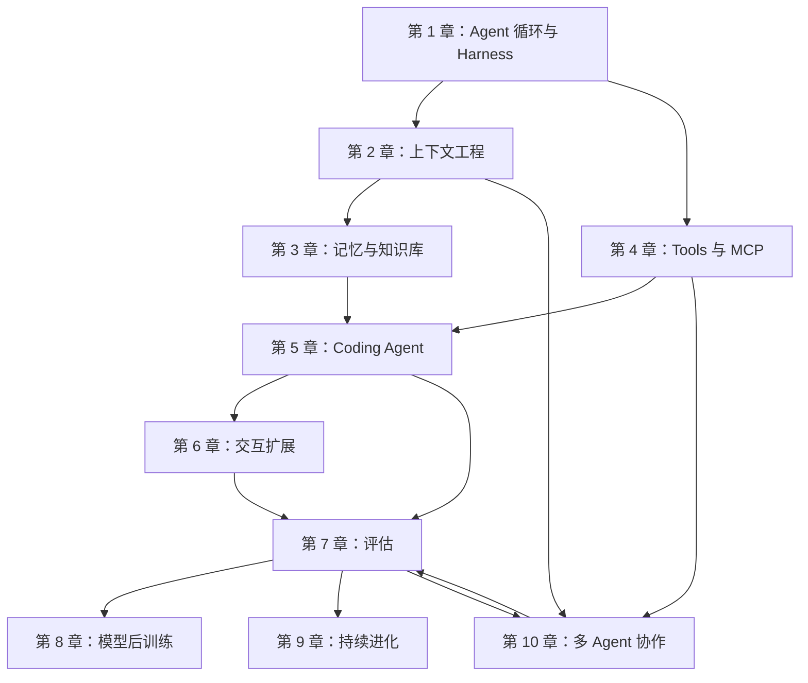

# ai-agent-book 学习路线与知识地图

整理日期：2026 年 10 月 26 日。依据《深入理解 AI Agent：设计原理与工程实践》v2.0 和[官方学习建议](https://github.com/bojieli/ai-agent-book/blob/main/docs/zh-CN/LEARNING.md)整理；图和路线是我自己的归纳，没有复制教材插图。

## 先抓住一条主线

我把这本书读成一个不断补齐的循环：**模型做决策 → 上下文提供依据 → 工具改变或观察环境 → Harness 校验并记录 → 根据结果继续或停止**。第 1–6 章侧重把 Agent 建起来；第 7–10 章分别讨论评估、模型后训练、持续改进和多 Agent 协作。后面四章不是每个项目都必须安装的一套“功能包”，要看实际问题再选。

箭头表示**学习依赖或需要回头验证的关系**，不是说读书只能按这个顺序，也不是某章完成后自然就有下一章的能力。尤其第 7 章评估要反过来检查第 1–6 章和第 10 章做出的系统。

## 十章各解决什么问题

| 章节 | 我想回答的问题 | 先抓住的词 | 目前状态 |
| --- | --- | --- | --- |
| [1 Agent 入门](https://github.com/bojieli/ai-agent-book/tree/main/chapter1) | 模型怎么决定下一步，工具结果怎么回到循环？ | ReAct、Harness、轨迹、停止条件 | ✅ Task 0：离线演示与真实 Kimi 联网搜索 |
| [2 上下文工程](https://github.com/bojieli/ai-agent-book/tree/main/chapter2) | 每一步该把哪些材料交给模型？ | Prompt 与 Context、窗口、压缩 | ✅ Task 1：上下文感知压缩 |
| [3 记忆与知识库](https://github.com/bojieli/ai-agent-book/tree/main/chapter3) | 用户偏好怎样跨会话更新，资料怎样被检索？ | 短期/长期记忆、RAG、BM25、Embedding | ✅ Task 2：记忆更新与 BM25 检索 |
| [4 工具](https://github.com/bojieli/ai-agent-book/tree/main/chapter4) | Agent 如何安全地看、写和调用外部能力？ | 五类工具、参数契约、权限、MCP | ✅ Task 3：执行工具 MCP Server |
| [5 Coding Agent](https://github.com/bojieli/ai-agent-book/tree/main/chapter5) | 代码生成之后怎样执行、观察并纠错？ | Read → Think → Edit → Execute → Observe | ✅ Task 4：代码辅助数学题的部分循环 |
| [6 交互扩展](https://github.com/bojieli/ai-agent-book/tree/main/chapter6) | 事件、语音、浏览器和机器人怎样扩展观察与动作？ | 异步、事件、Computer Use、多模态 | ✅ 实验 6-2：离线三场景与真实 Kimi 单场景；见[笔记](chapter6-interaction.md) |
| [7 Agent 评估](https://github.com/bojieli/ai-agent-book/tree/main/chapter7) | “更好”有没有证据，失败最早发生在哪一步？ | 环境、验证器、成功率、成本、统计 | ✅ 实验 7-9：保存轨迹的离线成本复算；见[笔记](chapter7-evaluation.md) |
| [8 模型后训练](https://github.com/bojieli/ai-agent-book/tree/main/chapter8) | 什么时候需要把能力写进模型参数？ | 数据、SFT、偏好训练、RL、留出评估 | ✅ 实验 8-17 的离线教学演示与 21 项测试；未训练模型；见[笔记](chapter8-post-training.md) |
| [9 持续进化](https://github.com/bojieli/ai-agent-book/tree/main/chapter9) | 从失败轨迹里总结的改进怎样安全发布？ | 轨迹、规则、Skill、回归、回滚 | ✅ 实验 9-1：启发式三层验证与 3 项测试；见[笔记](chapter9-evolution.md) |
| [10 多 Agent](https://github.com/bojieli/ai-agent-book/tree/main/chapter10) | 什么任务值得分角色，怎样交接上下文？ | Manager、共享文件、隔离、协作成本 | ✅ Task 5：四章翻译教学示例与单 Agent 对照 |

“✅”只表示我跑过表中写明的**具体范围**。例如 Task 4 是 11 道教学题，不是教材的 30 题正式验收；Task 5 是四章样例，不是整书正式评测。第 6 章的离线并发加速不能替代真实模型的回复耗时，第 7 章是假设价格下的复算，第 8 章没有训练，第 9 章没有运行真实 LLM 裁判。

## 我会怎样把十章连起来

1. **先把任务、工具和成功条件写明白。**第 1–5 章让我看清 ReAct 循环、上下文、记忆、工具和编码反馈怎么接起来。起步选一个真实的小任务，明确输入、允许调用的工具、停止条件与验收办法。
2. **再决定交互形态。**第 6 章的异步实验说明，后台任务、用户插话和 checkpoint 各有状态要管。需要长任务时才加异步；同时测后台完成时间和用户收到回答的时间。
3. **用第 7、9 章检查系统。**第 7 章先拆成功率、时延、token 和成本，第 9 章再沿轨迹拆结果、过程、表达，找到究竟哪一步出错。不要拿一个漂亮总分代替证据。
4. **遇到反复出现的模型决策错误，再看第 8 章。**过早结束可以先从提示词、工具反馈和验证规则改起；如果这些仍不能解决，再准备偏好数据、真实训练与留出评估。离线 mock 的好看分数不算模型改进。
5. **最后判断要不要多 Agent。**先用单 Agent 做基线。只有任务确实能分工、共享材料和审查收益够大时，再参考第 10 章的 Manager、翻译与审校协作，并把额外 token 成本算进去。

这是我做自己项目时会走的**实践路线**，不改变教材本身的第 1–10 章顺序。第 6–9 章目前各跑过一个相关实验，仍有更多正式训练、真实裁判和跨任务评估需要以后继续做。

## 我用来防止“看完就忘”的四个问题

- **它看到了什么？** 当前 Context、记忆和检索结果是否足够，是否有无关内容占窗口？
- **它做了什么？** 工具调用参数、权限和副作用是什么，失败有没有明确返回？
- **它怎么知道做完了？** 有没有可核对的文件、环境状态或验证器，而不只是模型说“完成了”？
- **值不值得？** 与简单方案相比，质量、延迟、token 和维护成本各有什么变化？

## 已完成的个人记录

[Task 0](task0-learning-note.md) · [Task 1](task1-context-engineering.md) · [Task 2](task2-memory-rag.md) · [Task 3](task3-tools-mcp.md) · [Task 4](task4-coding-agent.md) · [Task 5](task5-multi-agent.md) · [第 6 章](chapter6-interaction.md) · [第 7 章](chapter7-evaluation.md) · [第 8 章](chapter8-post-training.md) · [第 9 章](chapter9-evolution.md) · [文字版共学总结](final-learning-summary.md)

参考：[官方仓库章节总览](https://github.com/bojieli/ai-agent-book#-内容速览第-110-章)、[官方学习建议](https://github.com/bojieli/ai-agent-book/blob/main/docs/zh-CN/LEARNING.md)。
