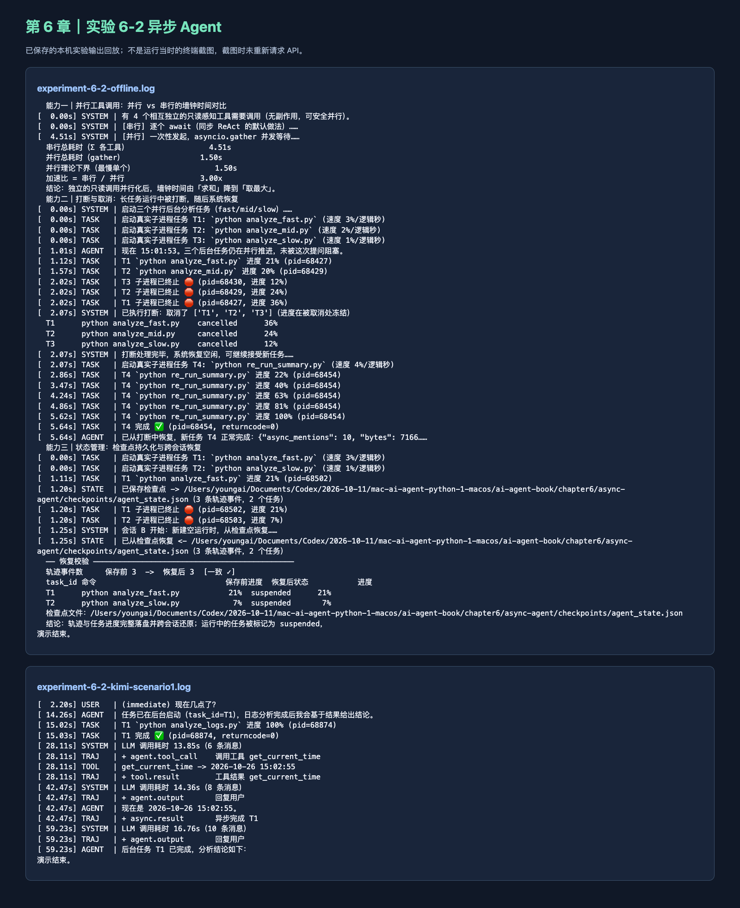

# Chapter 6：交互与异步 Agent

学习日期：2026 年 10 月 26 日。本篇是 Task 0–5 之外的章节拓展记录，不冒充新的官方打卡任务。

## 我做的实验

我按教材第六章实验 6-2，运行官方 `chapter6/async-agent/demo.py`。先跑 `offline`，再用已有的 Kimi API、`kimi-k3` 跑 `scenarios --scenario 1`。使用官方项目原有的 Python 3.12 虚拟环境，没改系统 Python。API Key 只在本机进程里读取。

离线部分展示了三个功能：串行任务约 4.51 秒，并行约 1.50 秒，约 3 倍加速；任务取消后启动新任务 T4 并完成；最后把 3 个轨迹事件和 2 个任务写进 checkpoint，再从文件恢复。真实 Kimi 场景则同时安排了后台章节分析和一条用户即时提问。后台任务约 15 秒完成，但模型到约 42 秒才答复即时提问，之后约 59 秒才给出后台分析结果。这里我只能说异步任务与事件回传链路跑通了，不能说这次真实模型“即时回复比后台任务更快”。

## 学习心得

以前我理解的 Agent 基本是一问一答，等模型和工具都跑完再往下走。第六章让我看到，后台任务可以有自己的状态，用户又能在中间插进一个新问题；Harness 得记住哪些任务还在跑、哪个结果属于哪次请求，取消和恢复也得有明确记录。离线演示中的加速很直观，但真实 Kimi 那次提醒我：程序并发了，用户不一定就更快看到回答，模型自己的推理耗时也会卡住交互。以后评估异步功能，我会把“任务完成时间”和“用户收到答复的时间”分开记。

## 课程反馈

我喜欢实验把并行、取消、checkpoint 放在一起演示；如果 README 再提醒读者区分后台任务耗时与模型回复延迟，会更容易看懂真实运行结果。

## 运行截图

下图是从两份本机保存的运行日志生成的结果回放页，不是运行当时的终端画面；截图时没有再次调用 API。

原始日志留在本机 `task6-interaction/results/`。参考：[官方实验 6-2](https://github.com/bojieli/ai-agent-book/tree/main/chapter6/async-agent)。
