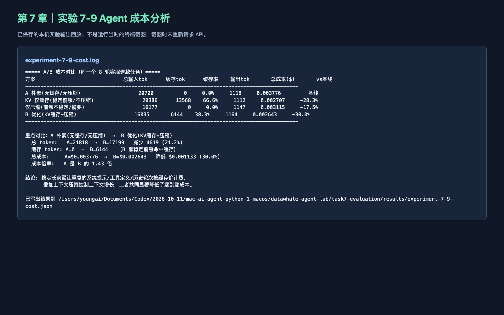

# Chapter 7：Agent 成本评估

学习日期：2026 年 10 月 26 日。本篇是课程 Task 0–5 之外的章节拓展。

## 我做的实验

我按教材第七章实验 7-9，运行官方 `chapter7/agent-cost-analysis/demo.py --offline --scenario all`，对同一条 8 轮客服退款任务比较朴素方案、只开 KV 缓存、只做压缩、缓存加压缩四种方案。官方样本轨迹采集自 `gpt-4o-mini`；本次脚本按命令默认的 `gpt-5.6-luna` 假设单价重新计价。这是**保存轨迹的离线复算**，没有向这两个模型发起新请求，也不能当成当前真实账单或实时定价。

| 方案 | 输入 token | 假设成本（美元） | 与基线相比 |
| --- | ---: | ---: | ---: |
| 朴素 | 20,700 | 0.003776 | 基线 |
| 只开缓存 | 20,386 | 0.002707 | 降 28.3% |
| 只做压缩 | 16,177 | 0.003115 | 降 17.5% |
| 缓存和压缩 | 16,035 | 0.002643 | 降 30.0% |

这里输入、输出和缓存 token 是脚本读入并变换的记录；美元成本按输入 0.15、缓存输入 0.075、输出 0.6 美元/百万 token 的**实验价格参数**计算。

## 学习心得

我原来只会看一次调用花了多少钱，没想到工具返回的内容会在后面多轮反复进入上下文。这个 8 轮样本里，朴素方案累计有 9,544 个工具返回注入 token，压缩后是 5,248。缓存处理的是重复前缀，压缩处理的是上下文里越攒越多的内容，两件事可以叠加，但不能只看省钱百分比。我以后会先问：压缩有没有丢掉关键证据？任务结果有没有变差？如果质量没验收，光看账单降低，不算真正优化成功。

## 课程反馈

这个 2×2 对照让我看清缓存和压缩分别省在哪里。建议官方把“录制时的模型”和“复算时的价格模型”并排显示得更醒目，避免读者把离线数字当成本次实际费用。

## 运行截图

下图是本机已保存日志的浏览器回放页，截图时没有新请求。

原始日志与 JSON 留在本机 `task7-evaluation/results/`。参考：[官方实验 7-9](https://github.com/bojieli/ai-agent-book/tree/main/chapter7/agent-cost-analysis)。
