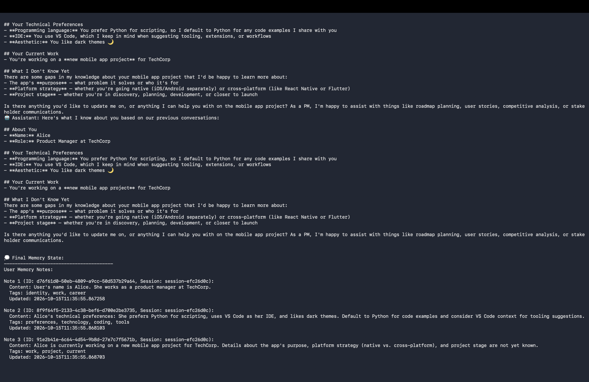
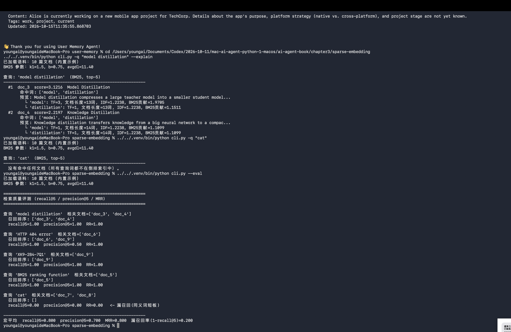
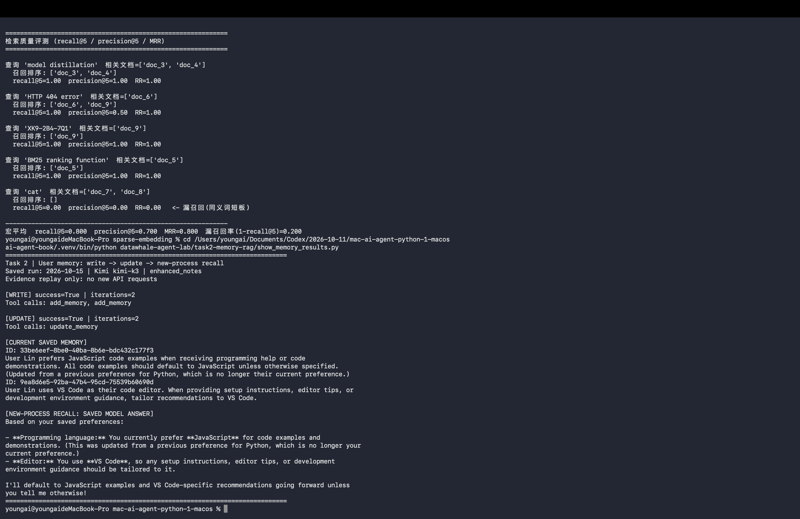

# Task 2：用户记忆和知识库

学习日期：2026 年 10 月 15 日

学习依据：李博杰《深入理解 AI Agent：设计原理与工程实践》v2.0（2026 年 9 月 23 日）PDF，第 3.1 节和第 85—86 页实验 3-5。页码为书内页码。

## 这次做了什么

这次沿用官方 ai-agent-book 仓库，使用 Python 3.12 环境，先执行 `uv sync --locked --python 3.12 --extra ch3`，然后完成用户记忆演示和教材实验 3-5 的 BM25 查询、同义词漏检观察及内置评测。

### 用户记忆演示

目录：`chapter3/user-memory`。使用已有 Kimi API，模型为 `kimi-k3`，记忆模式为 `enhanced_notes`，入口参数为：

```bash
../../.venv/bin/python main.py --mode demo --provider kimi --model kimi-k3 --memory-mode enhanced_notes
```

运行前需在本地加载 MOONSHOT_API_KEY。我的实际运行通过 python-dotenv 读取已有的本地配置再启动 main.py；密钥不写入笔记。

官方演示用的是虚构用户 Alice。后台通过三次 add_memory 调用保存了三条信息：她在 TechCorp 做产品经理；偏好 Python、VS Code 和深色主题；正在参与一个移动应用项目。后续会话读到了这些记忆，并据此回答了“What do you know about me and my work?”。最后输出 Final Memory State，程序正常结束。

### 偏好更新与重启后读取

只看到 Alice 的信息被记住，我还想知道修改偏好以后会怎样。所以我又用了一个虚构用户 Lin，把写入、更新和追问分成三个独立进程，调用的仍是官方 UserMemoryAgent 和 ConversationalAgent。运行脚本只负责启动和保存结果，记忆工具没有改写。

1. 先告诉它：代码示例偏好 Python，编辑器用 VS Code。两次 add_memory 成功，保存了两条记忆。
2. 再告诉它：现在改为偏好 JavaScript，编辑器不变。这次调用的是 update_memory，原来那条编程偏好的 ID 没变，内容改成了 JavaScript；Python 被标记为旧偏好。
3. 退出后重新启动一个进程，问当前偏好的语言和编辑器。回答是 JavaScript 和 VS Code，没有把旧偏好当成当前要求。

实际命令如下，在学习工作区根目录执行：

```bash
ai-agent-book/.venv/bin/python datawhale-agent-lab/task2-memory-rag/memory_lifecycle.py write
ai-agent-book/.venv/bin/python datawhale-agent-lab/task2-memory-rag/memory_lifecycle.py update
ai-agent-book/.venv/bin/python datawhale-agent-lab/task2-memory-rag/memory_lifecycle.py recall
```

写入和更新各用了两轮模型交互，后续回答另外调用了一次模型。这是一个小范围的更新与持久化检查，不是实验 3-1 的三层完整评估，也没有做实验 3-2 的四格式对照。

### 实验 3-5：BM25 搜索与评测

目录：`chapter3/sparse-embedding`。使用官方内置的 10 篇文档，参数 k1=1.5、b=0.75，平均文档长度为 11.40。

```bash
../../.venv/bin/python cli.py -q "model distillation" --explain
../../.venv/bin/python cli.py -q "cat"
../../.venv/bin/python cli.py --eval
```

第一条查询命中 doc_3（Model Distillation，3.1216 分）和 doc_4（Knowledge Distillation，2.2197 分）。输出列出了词频、IDF、文档长度及每个词的得分贡献。

查询 cat 没有命中，但标注中 doc_7 和 doc_8 是相关文档，展示了这套词项匹配实现的同义词短板。HTTP 404 error 查询找回目标 doc_6，同时也返回了不相关的 doc_9。

| 查询 | recall@5 | precision@5 | RR |
| --- | --- | --- | --- |
| model distillation | 1.00 | 1.00 | 1.00 |
| HTTP 404 error | 1.00 | 0.50 | 1.00 |
| XK9-2B4-7Q1 | 1.00 | 1.00 | 1.00 |
| BM25 ranking function | 1.00 | 1.00 | 1.00 |
| cat | 0.00 | 0.00 | 0.00 |
| 宏平均 | 0.800 | 0.700 | 0.800 |

程序报告的漏召回率为 0.200。这些数字只来自内置小语料和五个查询，不能代表真实知识库的检索水平。precision@5 按这份程序的计算方式记录，返回不足五条时并非统一除以五。

### 把教材里的中间过程也看一遍

```bash
../../.venv/bin/python cli.py -q "model distillation" --explain --verbose
../../.venv/bin/python benchmark.py
```

我打开详细日志，看到文档逐篇分词、过滤停用词、进入倒排索引，再计算查询得分。其中 Model Distillation 文档从 15 个词变为 13 个词，过滤掉了两个 a。model 和 distillation 都指向 doc_3、doc_4；cat 没有索引项，但 kitten、feline 分别指向 doc_7、doc_8，漏检的原因就很清楚了。

我还按 PDF 第 86 页给出的词频、文档长度和公式重新算了一遍。参数 N=10、k1=1.5、b=0.75、avgdl=250，得到：

| 文档 | 核算得分 | 教材展示值 |
| --- | --- | --- |
| doc_1 | 3.665182 | 3.67 |
| doc_7 | 1.684287 | 1.68 |
| doc_5 | 1.223775 | 1.22 |
| doc_3 | 0.823935 | 0.82 |

排序和四舍五入后的得分一致。这里是对教材所给统计量的计算核对，不是用完整原始中文语料重新建库。配套 CLI 的英文示例平均文档长度是 11.40，所以它的 3.1216 分不能拿来和教材的 3.67 分直接比较。

同样用教材参数，固定文档长度时，词频从 5 增加到 10，得分只从 1.465654 增到 1.656826；固定词频为 2 时，文档长度从 150 增加到 500，得分从 1.249410 降到 0.823935。这让我能把“词频饱和”和“长度归一化”与具体数字对应起来。

官方 benchmark.py 的实际验收结果：手算得分误差为 0；精确关键词 recall@5=1.000；同义词查询 recall@5=0.000。验收通过，结果保存在本次 2026 年 10 月 15 日生成的 validation/runs 目录中。

## 我的学习心得

之前我以为，让 Agent 记住用户，就是把聊天记录存下来。这次看到后台把 Alice 的几轮对话整理成三条记忆，后面再读出来回答，我才把“聊天记录”和“整理后可用的记忆”分开。短期记忆主要服务眼前这轮任务，长期记忆则需要跨会话保存。后来我又试了把 Python 偏好改成 JavaScript，重启后仍然能答对，这一步比单纯看到“保存成功”更让我放心。不过一个例子能通过，还不能说明遇到多人、多个时间点的冲突时也都能处理好。

检索实验里，最有感觉的是搜 cat 居然找不到相关文档。搜 model distillation 时结果很好，我一度觉得搜索已经够用了；换个表达就漏掉，才发现关键词命中和理解意思确实有差别。用户记忆关心“这个人说过什么、偏好有没有变化”，知识库更多是从资料里找回答问题的依据，两者都要检索，但保存和更新的对象不一样。

我对 RAG 的流程也更清楚了一点：文档先切成合适的块，再做 Embedding，把问题和内容转成便于比较的表示；Retrieval 找出相关材料，再交给模型组织回答。切块丢了上下文，或者检索没找对，后面的回答就可能缺依据。这次实际运行的是 BM25 检索，没有运行向量 Embedding、文档切分或完整 RAG 生成链路，这几部分目前还是通过教材学习理解。

## 课程反馈

修改偏好后再重启追问，以及换个词就搜不到，这两个小例子很直观。教材的手算语料和配套命令行示例不完全一样，如果入口处能说明区别，第一次做会少些困惑。后面想继续看混合检索能不能补上这次的漏检。

## 实验证据

### 用户记忆：读取结果和最终保存内容

后续回答用到了 Alice 的身份、技术偏好和当前项目，下面的 Final Memory State 显示了实际保存的三条记忆。这些是官方演示中的虚构用户信息。



### BM25：命中、漏检和评测

这张图保留了 model distillation 的逐词得分、cat 的漏检，以及五个查询的评测结果。宏平均 recall@5=0.800、precision@5=0.700、MRR=0.800。



### 偏好更新与重启后读取截图

这张截图是本次真实运行结果的回显，展示时没有再次请求 API。写入阶段调用了两次 add_memory，更新阶段调用 update_memory；保存的当前偏好变为 JavaScript，重启后的回答也读到了 JavaScript 和 VS Code。



## 参考

- 《深入理解 AI Agent：设计原理与工程实践》v2.0，第 3 章。
- [官方 Chapter 3](https://github.com/bojieli/ai-agent-book/tree/main/chapter3)
- [用户记忆演示](https://github.com/bojieli/ai-agent-book/tree/main/chapter3/user-memory)
- [实验 3-5](https://github.com/bojieli/ai-agent-book/tree/main/chapter3/sparse-embedding)
