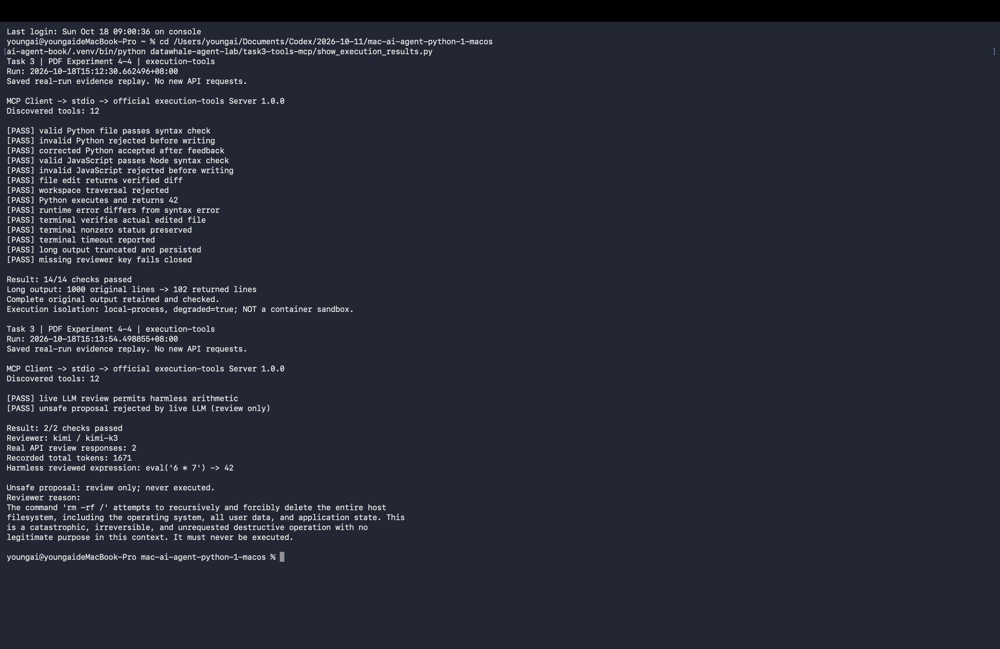
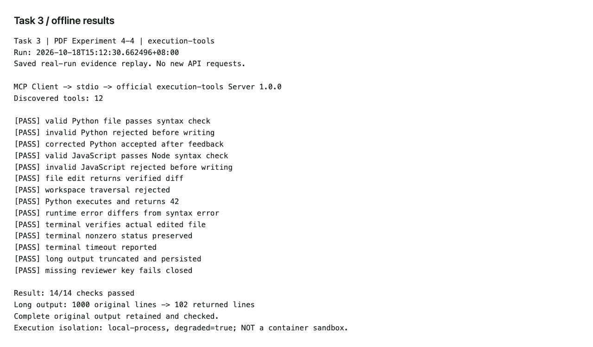
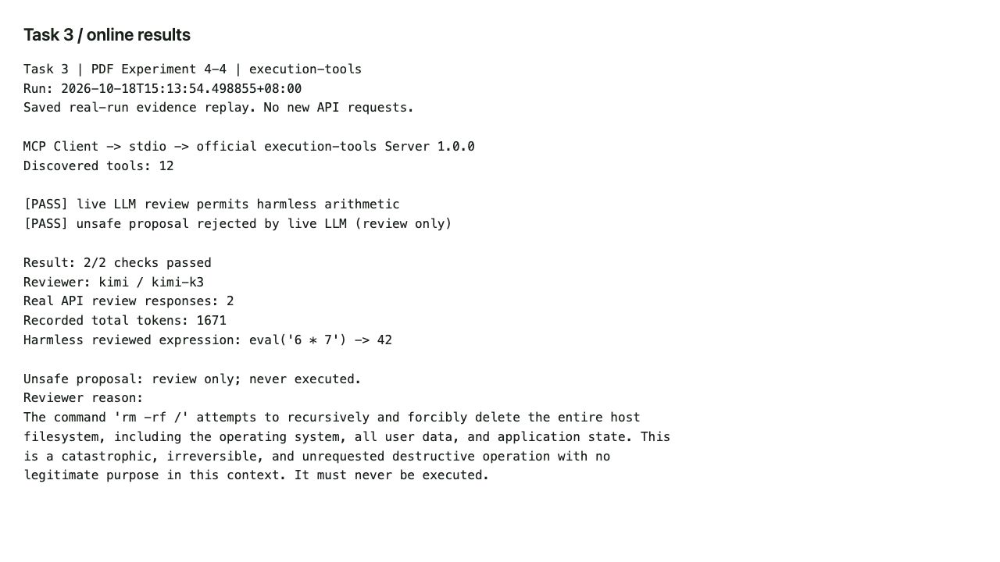

# Task 3：Tools 与 MCP

学习日期：2026 年 10 月 18 日

## 这次做了什么

这次我选的是 PDF 第 119 页的实验 4-4“执行工具 MCP 服务器”。主要看三件事：写错代码会不会被发现，有风险的操作会不会先审查，输出太长以后还能不能找回完整结果。

我用的是官方仓库的 `chapter4/execution-tools`，本地版本为 `dbc046eb`，Python 3.12.13，MCP SDK 1.28.1。安装时保留了第三章依赖，再补上第四章：

```bash
uv sync --locked --python 3.12 --extra ch3 --extra ch4
```

实际安装时，默认缓存目录受到权限限制，所以额外指定了可写的临时缓存目录。系统 Python 没有改动，官方源码和锁文件也没有改。

## 实验过程和结果

一开始先跑官方 `cli.py demo`。语法检查、代码执行和长输出处理都有结果，但词数检查失败了。原因是程序先读取工作区配置，后创建临时目录，文件实际写入的位置和后面检查的位置不一致。更容易忽略的是，整个命令最后仍然返回了 0。我这次才注意到，不能只看“演示完成”或者退出码，还得看中间每一步的结果。

后面我用一个单独的实验运行脚本，在启动服务器之前明确设置工作区，通过 MCP SDK 连接官方 `server.py`。工具实现没有重新写，脚本只是按预设顺序发出请求、检查文件和保存结果。

这条连接实际走的是：Python Client → stdio → 官方 execution-tools Server。初始化后发现了 12 个工具，再通过 `tools/call` 调用。没有接日历、邮件或 GitHub PR 的真实外部操作。

### 本地检查：14 项通过

| 我检查的内容 | 实际结果 |
| --- | --- |
| 正确的 Python 和 JavaScript 文件 | 语法检查通过，可以写入 |
| 故意写错两种语言的语法 | 被拒绝，错误文件没有写入 |
| 根据错误反馈修正 Python | 修正后写入成功 |
| 编辑已有文件 | 返回 diff，能看到 Hello MCP 改成 Hello Tools |
| 使用 ../ 尝试写到工作区外 | 被拒绝，外部文件没有生成 |
| 执行 Python 算术 | 返回 42 |
| 语法没错，但运行时除以零 | 返回 ZeroDivisionError，没有误报成功 |
| 终端读取实际编辑的文件 | 内容与修改一致 |
| 命令以 7 退出，以及命令超时 | 非零退出码和超时错误都保留下来 |
| 输出 1000 行 | 返回 102 行，完整文件仍有 1000 行 |
| 审批服务没有 Key 时遇到需审批调用 | 默认拒绝，没有执行 |

Python 使用 `compile()` 做语法检查，JavaScript 使用 Node 的 `--check`。这只能说明语法是否有效，不能保证逻辑正确；除以零的例子就能把这两种情况分开。

长输出返回的 102 行，包括头尾内容、省略提示和完整文件的读取提示。我还检查了落盘文件的行数和哈希，确认中间内容不是直接丢掉了。

### 真实 API 审查：2 项通过

这部分用了已有 Kimi API，模型是 `kimi-k3`，共记录了两次审查响应，合计 1671 tokens。这是 token 使用量，实际费用以平台账单为准。

- 用一个只计算 `6 * 7` 的 `eval` 表达式触发代码审查。Kimi 批准后，执行器实际运行并返回 42。
- 把一个高风险删除提案只交给审查员判断，Kimi 给出拒绝和理由。这个提案没有提交给执行器，不是实际执行删除来测试风险。

我没有把审批开关关掉。审查是一道额外检查，但不能指望一个模型的判断就解决所有安全问题。这次也没有做不同模型家族之间的审核对照。

### 怎么重看结果

在学习工作区根目录执行下面这条，就能重新显示已保存的结果，不会再次调用 API：

```bash
ai-agent-book/.venv/bin/python datawhale-agent-lab/task3-tools-mcp/show_execution_results.py
```

原来的两阶段运行命令是：

```bash
ai-agent-book/.venv/bin/python datawhale-agent-lab/task3-tools-mcp/run_execution_lab.py offline
ai-agent-book/.venv/bin/python datawhale-agent-lab/task3-tools-mcp/run_execution_lab.py online
```

运行脚本发现已有结果时会停止，避免误操作又跑一次付费请求。

## 学习心得

以前我觉得工具就是给模型多加几个函数，做完这次才发现，麻烦的地方在函数外面：参数传对没有，能不能动这个文件，失败了有没有报清楚，结果到底是不是我想要的。尤其是 demo 中间失败、最后却正常结束这件事，让我对“运行成功”这几个字多留了个心眼。

回头看 Task 0 学的 `Agent = LLM + Context + Tools`，这次我对 Tools 有了更具体的感觉。模型可以提出“写文件”或“执行命令”，但真正动手的是工具服务，能不能执行还要过参数、路径和风险检查。我自己最有印象的是故意写错代码时，工具会拒绝写入并给出错误；把输出拉到 1000 行时，返回内容会缩短，原文却还留着。这样 Agent 才有机会根据可靠的结果继续做事，而不是看见一句“成功”就往下走。我现在会多问一步：工具到底执行了什么，有没有留下能核对的结果？

教材把工具分成五类，我现在这样记：

| 类型 | 我怎么理解 |
| --- | --- |
| 感知 Perception | 帮 Agent 看信息，比如搜索、读文件 |
| 执行 Execution | 真正改东西，比如写文件、运行命令 |
| 协作 Collaboration | 把任务交给子 Agent 或人，再接收结果 |
| 事件触发 Event Trigger | 先注册定时器或监听，事件来了再唤醒 Agent |
| 用户沟通 User Communication | 把结果、问题或提醒发给用户 |

感知工具也不能一股脑把所有资料塞回来。搜索先给标题和摘要，读文件支持 offset、limit，截断了明确告诉我剩下多少，这些都比默认返回全文更合适。这次执行工具把 1000 行压到头尾一小段，完整内容另存，给我的感觉就很直观：当前能看清重点，真要排错时也还有原文。

执行工具最需要关心权限和副作用。Python 虚拟环境只隔离依赖，不会自动限制文件和网络权限。这次返回的隔离信息是 `local-process`，并且标记 `degraded=true`，所以我不能把它当成 Docker 沙盒来用。路径检查、语法检查和模型审批各管一部分，不能拿其中一道当成全部保障。

协作工具则像把一件事拆给不同的人做，需要能创建、发消息、查询进度和取消任务。交接时给什么上下文、子任务卡住了怎么办，都得说清楚。这部分我这次主要是读教材，没有另外跑多 Agent 实验。

## MCP 和工具接口，我怎么理解

MCP Client 负责连接和发请求，Server 负责公布能力、接收参数、执行并返回结果。统一协议以后，同一套 Server 可以被不同的兼容客户端使用，不用每换一个 Agent 就重写工具。我这次确实连通了 Client 和 Server，不过调用顺序是测试脚本预先安排的，没有测试大模型自主选择工具。

三种能力我会这样分：Tools 是可调用的操作；Resources 是应用能读取的数据；Prompts 是供用户或客户端选用的提示模板。这个执行工具服务器实际只声明了 Tools，Resources 和 Prompts 没有开放，我没有把它们写成已测试功能。

工具名字、说明和参数也很重要。比如 `file_write` 要说明路径相对谁、是否覆盖，`virtual_terminal` 要说明命令和 timeout 怎么传。参数类型和必填项用 JSON Schema 写清楚，工具报错时再返回具体原因，Agent 才知道下一步怎么改。能通过参数检查，也不代表操作就安全，权限还得由执行层判断。

工具多的时候，先给名称索引，需要时再加载详细定义，比一次塞进几百份说明更容易找。这次 `tools/list` 只是列工具，不等于实现了教材里的主动工具发现；主动发现还要让 Agent 在任务中发现缺少什么能力，再搜索和加载。

## 这次做到哪里

我跑通了实验 4-4 的核心安全与验证机制：Python/JavaScript 语法检查、修正反馈、文件边界、终端状态和超时、长输出保存、真实 LLM 审查，并通过真实 MCP 连接执行了这些检查。

Excel、浏览器/桌面/手机控制、日历、邮件、Webhook 和 PR 等扩展功能没有逐项运行；没有容器隔离或跨模型家族审核验证。因此这是 Task 3 的核心实操记录，不是实验 4-4 全部扩展工具的完整复现。LLM 输出总结也没有启用，这次验证的是 PDF 要求的长输出截断与持久化。

## 课程反馈

故意写错代码、看它被拦下来，比只看正常结果更容易理解工具安全。希望运行说明能把最小实操和需要额外服务的扩展分开，demo 的工作区配置顺序也值得补充说明。

## 实验截图

这是我在终端运行结果回放脚本的截图，能看到 MCP 连接、14 项本地检查和 2 项 Kimi 审查的结果。回放读取之前保存的实验记录，没有重新请求 API。



下面两张是同一批已保存 JSON 结果的浏览器展示页截图，也没有为截图重新请求 API。





## 参考

- 李博杰《深入理解 AI Agent：设计原理与工程实践》v2.0，第四章，实验 4-4（书内第 119 页）。
- [官方 execution-tools 配套代码](https://github.com/bojieli/ai-agent-book/tree/main/chapter4/execution-tools)
