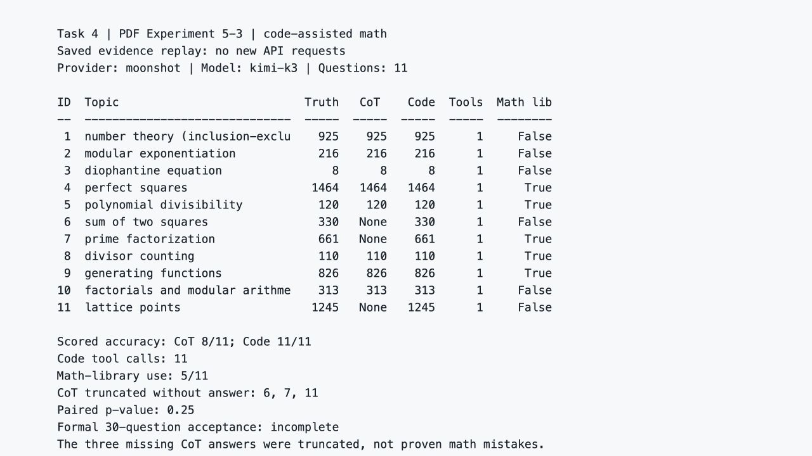

# Task 4：Coding Agent 与通用 Agent

学习日期：2026 年 10 月 21 日

## 这次跑了什么

我按《深入理解 AI Agent：设计原理与工程实践》v2.0 第五章，运行了 PDF 实验 5-3“使用代码生成工具提升数学解题能力”。用的是官方 `chapter5/code-for-math/demo.py`，Python 3.12.13，模型是已有的 Moonshot `kimi-k3`。没有改系统 Python，也没有把 API Key 放进笔记或截图。

先跑离线自检，官方内置 11 道题的参考解全部命中真值，结果是 `11/11`。然后用同一个 Kimi 模型，对同一批题分别跑纯文字推理和代码辅助。代码辅助模式把模型生成的 Python 交给 `run_python` 子进程执行，再把结果交回模型。第一次只跑前 3 题确认链路，之后用官方 `--resume` 续跑到 11 题，没有重复请求前 3 题。

本次是第四章依赖已在的共用官方虚拟环境上补装第五章依赖，安装命令保留了先前章节的依赖：

```bash
uv sync --locked --python 3.12 --extra ch3 --extra ch4 --extra ch5
```

`ch3` 和 `ch4` 只是保留共用环境中的依赖。这篇笔记没有把 Task 2、Task 3 的实验算进 Task 4。

## 运行结果

| 检查项 | 这次的结果 |
| --- | --- |
| 离线参考解自检 | 11/11 |
| 真实 Kimi 纯推理按程序规则得分 | 8/11 |
| 真实 Kimi 代码辅助按程序规则得分 | 11/11 |
| 代码辅助的沙箱工具调用 | 11 题各 1 次，共 11 次 |
| 生成代码使用 `sympy`、`numpy` 或 `scipy` | 5/11 题 |
| 配对检验 | `p=0.25`，不能说有统计显著提升 |

有个细节比表面分数更重要：纯推理未得分的第 6、7、11 题，API 记录中的 `finish_reason` 都是 `length`，返回的可见答案正文为空，因此程序提取不到整数。这说明它们是**输出被截断、没有交出可判分答案**，不能直接说 Kimi 的数学计算错了。代码辅助确实都返回了正确整数，但这组 11 题不足以证明一般情况下“代码一定更准”。

官方正式验收使用固定的 30 道 AIME 2024 题；我这次跑的是官方自带的 11 道教学题。结果 JSON 自己也标记 `official_complete=false`，所以我把它当成 Task 4 的一次真实相关实验，不写成“实验 5-3 的正式 30 题验收已完成”。

在学习工作区根目录运行下面的命令，可以回放已保存结果，不会再调用付费 API：

```bash
ai-agent-book/.venv/bin/python datawhale-agent-lab/task4-coding-agent/show_math_results.py
```

这次使用的原始结果保存在学习项目的 `task4-coding-agent/results/experiment-5-3-20261021/math-kimi-11.json`。回放脚本只读这个 JSON。

## 学习心得

我以前把 Coding Agent 想得很简单，好像模型会写一段代码就算完成任务了。读完第五章，再看这次的运行过程，我觉得真正关键的是后面那几步：代码要能执行，执行结果要回到模型，最后还要拿题目真值核对。第 6、7、11 题尤其提醒我，看到一个“错”字不能马上下结论，得往回看接口是不是截断了、有没有给出完整答案。以后看 Agent 跑代码，我会先查它到底调用了什么、返回了什么、验收标准是什么。

我现在把完整的编码循环理解成 **Read → Think → Edit → Execute → Observe**：先读项目和需求，想清楚改哪里，编辑文件，执行测试，再看错误或通过结果决定是否继续。光写完代码就停，像交卷前没检查。这次数学实验只实际演示了其中“生成代码、执行、观察反馈”的一部分，没有让 Coding Agent 读取并修改真实项目文件，也没有把它说成跑通了整个软件开发循环。

通用 Agent 的任务范围更宽，可能要查网页、整理资料、处理表格、沟通用户或调用其他服务。对于开放任务，Coding Agent 的文件和代码能力可以作为核心，再接上这些工具；但像固定流程的客服任务，也可能主要靠业务工具和规则。我觉得两者最大的区别不是名字，而是它能碰的环境、能做的动作，以及怎么判断事情真的做完了。

## 课程反馈

这次最有收获的是对照原始记录看失败原因。希望教材把“示例跑通”和“正式评测通过”的判据放得更近一些，新手不容易把 11 题结果误当成 30 题结论。

## 环境与结果截图

下图是读取本次真实运行保存的 JSON 后，在本机浏览器展示的结果回放页。它不是运行当时的终端截图，回放时也没有重新请求 API。



## 参考

- 李博杰《深入理解 AI Agent：设计原理与工程实践》v2.0，第五章，Coding Agent 机制与实验 5-3。
- [官方 Chapter 5 说明](https://github.com/bojieli/ai-agent-book/tree/main/chapter5)
- [官方 code-for-math 实验代码](https://github.com/bojieli/ai-agent-book/tree/main/chapter5/code-for-math)
