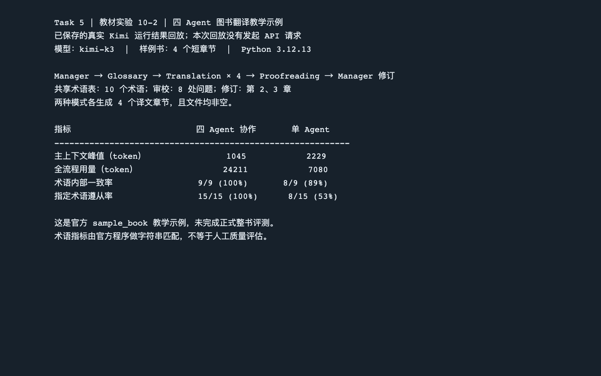

# Task 5：多 Agent 协作

学习日期：2026 年 10 月 25 日

## 这次做的实验

我按《深入理解 AI Agent：设计原理与工程实践》v2.0 第十章，跑了官方实验 10-2 的 `chapter10/book-translation` 教学示例。用的是官方自带的四个英文短章节，Python 3.12.13 和已有的 Kimi API（`kimi-k3`）。先用 `--dry-run` 看了一遍协作计划，再跑真实模型调用，并保留单 Agent 对照。API Key 只在本机进程里读取，没有写进项目、截图或笔记。

四个角色的分工挺直观：Manager 安排任务并保存文件路径；Glossary 先看整本样例，生成共享术语表；Translation 每次只看自己负责的章节和术语表；Proofreading 读译文后提出问题。最后 Manager 根据报告，把第 2、3 章发回修订。角色之间主要靠术语表、译文文件和审校报告传信息，不是把所有内容都塞进一段对话。

## 我看到的结果

| 项目 | 四 Agent 协作 | 单 Agent |
| --- | ---: | ---: |
| 生成译文 | 4 章 | 4 章 |
| 主上下文峰值 | 1,045 tokens | 2,229 tokens |
| 全流程 token 用量 | 24,211 | 7,080 |
| 术语内部一致率 | 9/9（100%） | 8/9（89%） |
| 指定术语遵从率 | 15/15（100%） | 8/15（53%） |

协作模式生成了 10 个共享术语，审校报告列了 8 处问题，并触发两章修订。这里的术语分数是官方程序做的字符串匹配，不是人工翻译质量打分。上下文峰值的口径也要分清：表里比较的是 Manager 保存的状态与单 Agent 的主上下文；协作流程还有其他角色自己的上下文。这个四章示例说明了分工的效果和成本，不能代表教材要求的整书正式评测已经完成。

## 学习心得

以前我听到“多 Agent”，第一反应是让几个模型一起干活，应该更快、更厉害。这次实际跑下来，感觉没这么简单。翻译任务能拆成术语、逐章翻译、审校和修订，所以分角色确实有用：每个翻译角色只拿自己需要的材料，Manager 也不用一直背着整本书。最明显的是指定术语，协作组按术语表统一了译法，单 Agent 有些词就按自己的习惯翻了。

但账单也提醒了我：协作组用了 24,211 tokens，单 Agent 只用 7,080。多出来的术语抽取、审校和返工都有代价。如果只是翻一小段文字，我会先用单 Agent；如果是多章内容、多人交接或必须统一术语的任务，再考虑多 Agent。Planner、Researcher、Executor、Reviewer 也可以按这个思路分工：先拆任务，研究者交证据，执行者做事，审查者检查结果。不过角色越多，交接信息越要写清楚，不然很容易重复劳动。

## 课程反馈

这章最有帮助的是把“分工有没有收益”放到具体结果里看。希望教材把示例演示和正式整书评测的界线再写醒目一点，我刚开始差点以为跑完四章就算完成全部验收。

## 环境运行结果截图

下图是读取这次真实 Kimi 运行留下的译文、术语表、审校报告和结果汇总后，在本机浏览器打开的回放页；截图时没有重新请求 API。它不是当时的终端画面。



在学习工作区根目录可以用下面的命令再次查看已保存的结果，不会产生新的 API 费用：

```bash
ai-agent-book/.venv/bin/python datawhale-agent-lab/task5-multi-agent/show_translation_results.py
```

本机原始产物保存在 `datawhale-agent-lab/task5-multi-agent/results/experiment-10-2/`，包括两种模式各四章译文，以及协作模式的 `glossary.json` 和 `proofreading_report.json`。

## 参考

- 李博杰《深入理解 AI Agent：设计原理与工程实践》v2.0，第十章，实验 10-2。
- [官方 Chapter 10 说明](https://github.com/bojieli/ai-agent-book/tree/main/chapter10)
- [官方 book-translation 示例代码](https://github.com/bojieli/ai-agent-book/tree/main/chapter10/book-translation)
