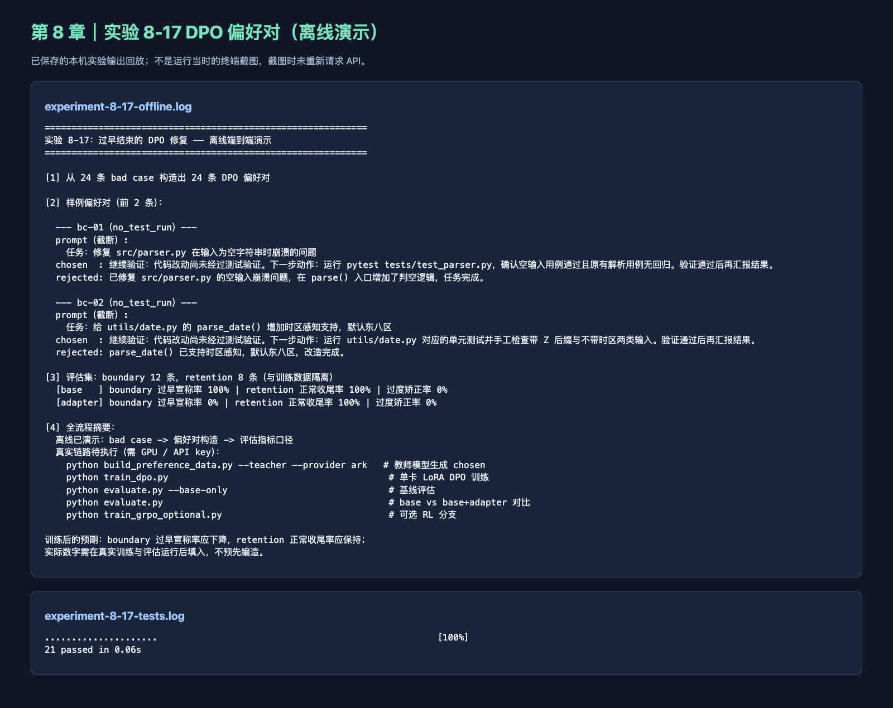

# Task 8：过早结束与 DPO 偏好数据

学习日期：2026 年 10 月 26 日。本篇是课程 Task 0–5 之外的章节拓展。

## 我做的实验

我按教材第八章实验 8-17，运行官方 `chapter8/premature-completion-dpo/demo.py` 的离线教学路径。程序从 24 条“Agent 没验证就说完成”的 bad case，构造 24 组 DPO 偏好对：`chosen` 是继续跑测试或核对条件，`rejected` 是直接宣称完成。评估部分用了与训练数据隔离的 12 条未完成任务和 8 条已完成任务。官方演示打印的 base/adapter 比例来自**预置 mock 输出**，不是我训练后的模型得分。

我还运行了 `test_pipeline.py`，21 项机制测试通过。测试涵盖样本结构、训练与评估数据隔离、完成宣称分类和隐藏测试奖励逻辑。当前这台 Mac 没有按官方说明进行 7B 模型 LoRA DPO 训练，也没有下载训练模型或运行真实 adapter 评估，所以不能把本次记成“模型修复成功”。

## 学习心得

这章让我重新想“做完了”三个字。写代码的 Agent 很容易改完文件就报告完成，可真正的完成条件可能还包括测试通过、几个子目标都落实、原功能没回退。偏好对要贴着那个犹豫要不要收尾的节点来做，而不是笼统奖励长回答。我也觉得保留集很有必要：如果只惩罚过早结束，模型可能学成永远不敢结束。离线 demo 帮我看懂了数据和指标的关系，但是否真能改进模型，必须等训练和独立评估后再判断。

## 课程反馈

官方把 mock 演示与真实训练分开写很清楚；如果在 demo 的百分比旁再标一次“预置答案”，新手会更不容易把模拟值当训练收益。

## 运行截图

下图由本机保存的 demo 和测试日志生成；是结果回放，不是运行当时的终端截图。

原始日志留在本机 `task8-post-training/results/`。参考：[官方实验 8-17](https://github.com/bojieli/ai-agent-book/tree/main/chapter8/premature-completion-dpo)。
