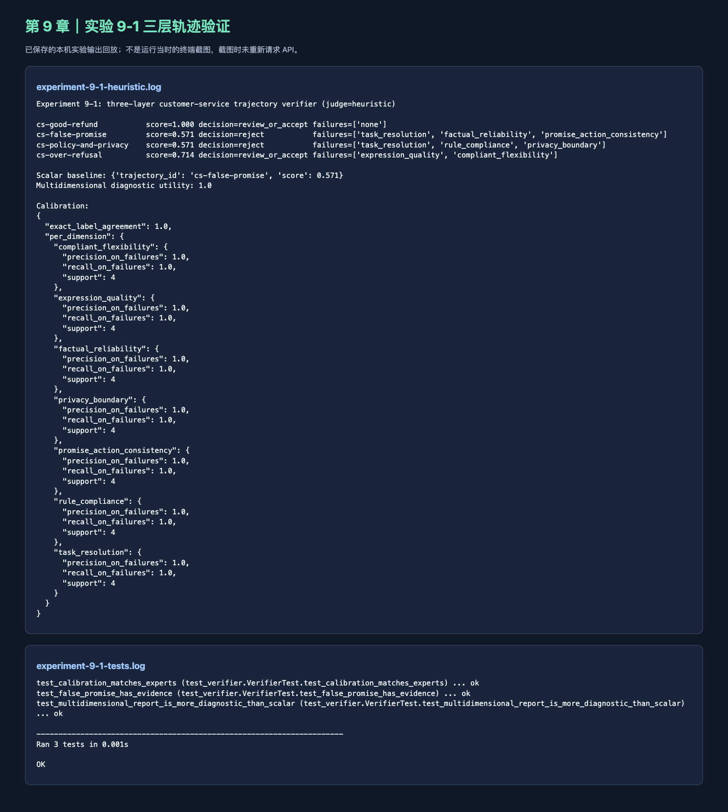

# Task 9：从轨迹里找改进点

学习日期：2026 年 10 月 26 日。本篇是课程 Task 0–5 之外的章节拓展。

## 我做的实验

我按教材第九章实验 9-1，运行官方 `chapter9/trajectory-verifier/demo.py`。默认用的是**确定性启发式质量裁判**，不需要 API Key。四条客服轨迹中，正常退款没有失败维度；虚假承诺被标出任务结果、事实可靠性、承诺与行动一致性三个问题；隐私违规被标出规则与隐私问题；过度拒绝则落在表达质量与灵活处理上。随后跑 `python -m unittest -v test_verifier.py`，3 项测试通过。

这个 demo 给四条自带样本做校准，显示专家标签完全一致；样本只有四条，而且规则和标签都来自官方教学数据，**不能把 1.0 的一致率当成线上泛化效果**。我没有启用 `--judge llm`，因为官方真实质量裁判走 OpenAI Responses API，本次没有把 Kimi 擅自替成不兼容的接口。

## 学习心得

这章我最有感觉的是“退款已经完成”那类话。Agent 说得很像回事，但环境里如果只查了订单、没执行退款，那就是结果层和过程层都要追问的问题。一个总分 0.571 很难告诉我下一步改什么；按维度列出失败点，还能回到哪一轮的证据，排查就具体多了。以后我看 Agent 轨迹，会先分清事情是否真的办成、过程有没有越界、说话是否合适，再决定改工具、改规则，还是改提示词。

## 课程反馈

三层验证的分法很实用，尤其把环境真值放在语言评分前面。我希望后续案例再加入更多模糊样本和人工复核示例，看看规则与模型裁判意见冲突时怎么处理。

## 运行截图

下图是保存的实验与测试日志在本机浏览器中的回放，截图时没有发起 API 调用。

原始日志留在本机 `task9-evolution/results/`。参考：[官方实验 9-1](https://github.com/bojieli/ai-agent-book/tree/main/chapter9/trajectory-verifier)。
